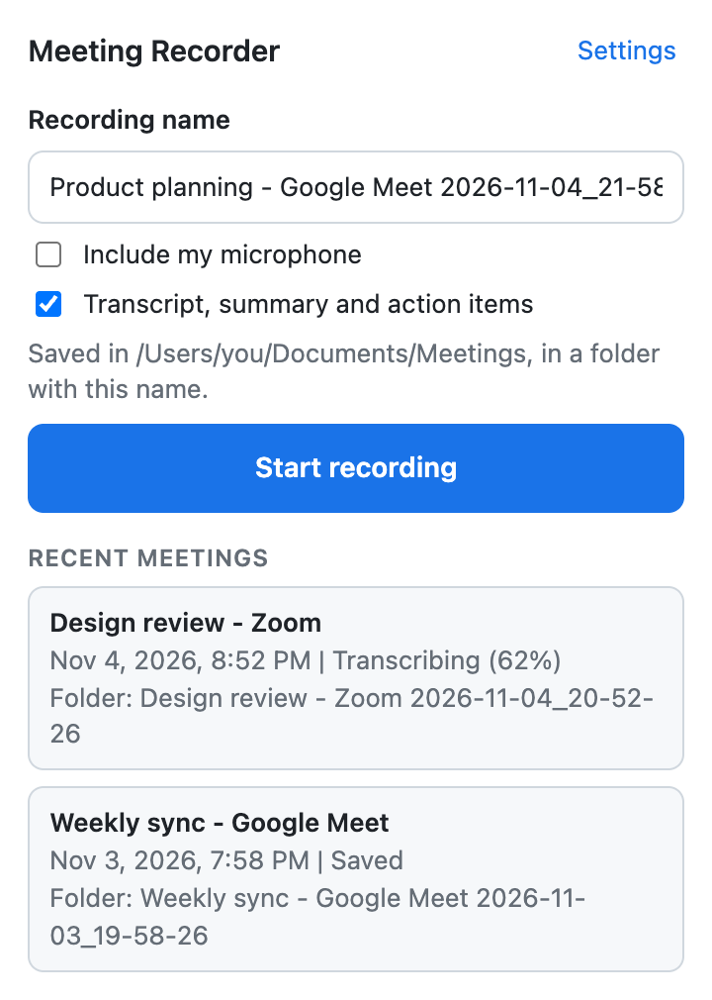
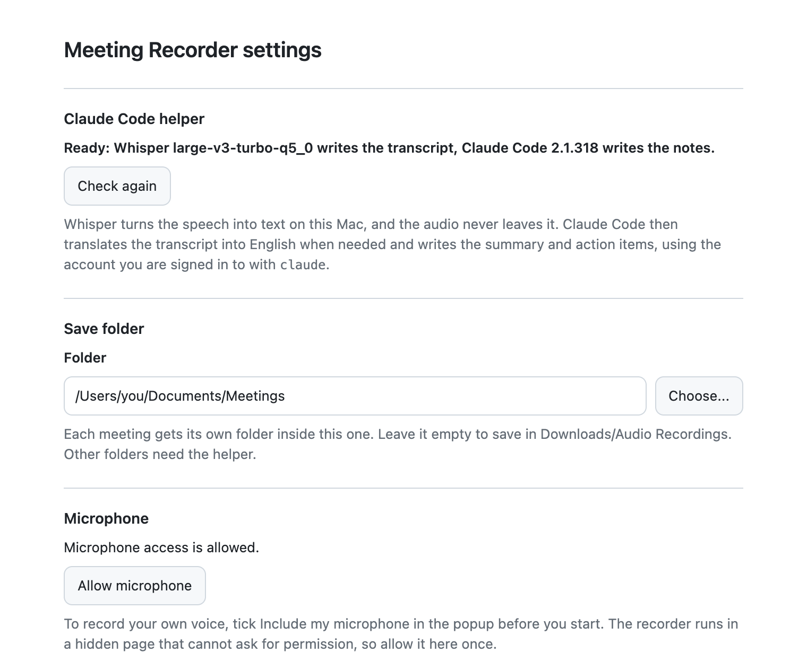

# Meeting Recorder(tabscribe)

Record a meeting you join in Google Chrome, such as Google Meet, Zoom or Microsoft Teams in the browser, and get:

- an MP3 recording of the meeting, with your own voice if you want it
- a written transcript in English, even when the meeting was in another language
- a PDF summary with the key points, the decisions and a checklist of action items

Everything is saved in a folder you choose. The audio never leaves your Mac: [Whisper](https://github.com/ggml-org/whisper.cpp) turns the speech into text on your Mac, and [Claude Code](https://code.claude.com/docs/en/setup) writes the summary using your own Claude account.

<p align="center">
  
</p>

**Contents:** [What you get](#what-you-get) · [What you need](#what-you-need) · [Set up](#set-up) · [Record a meeting](#record-a-meeting) · [Troubleshooting](#troubleshooting) · [Update](#update-to-a-new-version) · [Uninstall](#uninstall) · [Privacy](#privacy) · [Limits](#limits) · [For developers](#for-developers)

## What you get

Each meeting gets its own folder inside the folder you choose:

```
Meetings/
└── Weekly sync - Google Meet 2026-11-04_14-05-33/
    ├── recording.mp3            the audio
    ├── transcript.md            the English transcript, with timestamps
    ├── transcript-original.md   only when the meeting was not in English
    ├── summary.pdf              summary, key points, decisions and action items
    ├── summary.md               the same summary as text you can edit
    └── meeting.json             details such as the date and the length
```

The folder is named after the meeting's tab, plus the date and time. You can change the name before you start. A meeting recorded without a transcript has only `recording.mp3` and `meeting.json`.

The `.md` files are plain text. To open one, right-click it and choose **Open With › TextEdit**.

## What you need

- **A Mac** with macOS 13 (Ventura) or newer, and an administrator account on it. Macs with Apple silicon (M1 or later) make transcripts faster.
- **Google Chrome** 116 or newer.
- **A Claude plan that includes Claude Code**, for transcripts and summaries: Pro, Max, Ultra, Team or Enterprise, or a Claude Console account. The free plan does not include Claude Code. You can record without one.
- **About 4 GB of free disk space**, mostly for Apple's developer tools and the speech model.
- **An internet connection and about 30 minutes** for the setup, most of it spent waiting for downloads.

You don't need to know how to program. You copy a few commands into Terminal, the Mac app for typing commands.

### Using Terminal

Read this before you start:

- **Open Terminal:** press **Command (⌘) + Space**, type `Terminal`, and press **Return**.
- **Run a command:** on this page, click the copy button at the right of the command. Click in the Terminal window, press **⌘ + V**, then press **Return**.
- **Wait for it to finish.** A command is done when a new line ending in `%` appears.
- **Your password doesn't show.** When Terminal asks for your Mac password, type it and press **Return**. Nothing appears while you type, which is normal.
- **Check the last lines.** If something goes wrong, the last few lines say what happened. Look for that message under [Troubleshooting](#troubleshooting).

## Set up

Do these steps once, in this order.

### Step 1: Install Homebrew

Homebrew installs Whisper, the tool that turns speech into text.

1. Check whether you already have it:

   ```bash
   brew --version
   ```

   If it prints `Homebrew` and a version number, go to Step 2. If it says `command not found: brew`, continue.

2. Install Homebrew:

   ```bash
   /bin/bash -c "$(curl -fsSL https://raw.githubusercontent.com/Homebrew/install/HEAD/install.sh)"
   ```

   It explains what it will do and waits for you to press **Return**. It asks for your Mac password. If your Mac doesn't have Apple's command line developer tools yet, it installs them too, which can take a while.

3. Read the end of what it printed. If it shows **Next steps** with commands to run, copy and run each of them. They let Terminal find Homebrew.
4. Close the Terminal window, open a new one, and run `brew --version` again. It now prints a version number.

### Step 2: Install Node.js

Node.js runs the setup and the helper program that the extension uses.

1. Check whether you already have it:

   ```bash
   node --version
   ```

   If it prints `v22.12.0` or a higher number, go to Step 3.

2. Go to [nodejs.org/en/download](https://nodejs.org/en/download) and download the macOS installer for the **LTS** version.
3. Open the downloaded file and follow the installer.
4. Open a new Terminal window and run `node --version`. It prints `v22.12.0` or higher.

If you install or update Node.js another way later, such as with Homebrew, run `npm run setup` again afterwards (see Step 7).

### Step 3: Install Claude Code and sign in

Claude Code writes the summary and translates meetings that weren't in English. Skip this step if you only want recordings.

1. Install it:

   ```bash
   curl -fsSL https://claude.ai/install.sh | bash
   ```

   It shows no progress while it downloads, so wait until it finishes.

2. Close the Terminal window, open a new one, and check the install:

   ```bash
   claude --version
   ```

   It prints a version number, such as `2.1.318 (Claude Code)`. If it says `command not found: claude`, see Claude's [Fix your PATH](https://code.claude.com/docs/en/troubleshoot-install#command-not-found-claude-after-installation) guide.

3. Start Claude Code to sign in:

   ```bash
   claude
   ```

   Follow the steps on screen and sign in with your Claude account in the browser window that opens. When you're signed in, type `/exit` and press **Return** to close Claude Code.

### Step 4: Download Meeting Recorder

1. At the top of this page on GitHub, click the green **Code** button, then **Download ZIP**.
2. Open your **Downloads** folder. If you see a ZIP file, double-click it to unzip it. You get a folder named something like `meeting-recorder-main`.
3. Rename the folder to `meeting-recorder`.
4. In Finder, press **Shift + ⌘ + H** to open your home folder (it has a house icon), and drag the `meeting-recorder` folder into it.

Keep the folder there, with that name. Chrome runs the extension from it, and the commands below expect it there. A folder in Documents or Desktop also works, but then macOS asks extra permission questions.

### Step 5: Build the extension

1. In Terminal, go to the folder:

   ```bash
   cd ~/meeting-recorder
   ```

2. Download the parts the extension is built from:

   ```bash
   npm install
   ```

   This takes a minute or two. Lines that start with `npm warn` are fine; `npm error` means it failed.

3. Build the extension:

   ```bash
   npm run build
   ```

   It's done when the last line starts with `✓ built in`. This creates a `dist` folder inside `meeting-recorder`.

### Step 6: Add the extension to Chrome

1. In Chrome, open a new tab, type `chrome://extensions` in the address bar, and press **Return**.
2. Turn on **Developer mode** at the top right.
3. Click **Load unpacked** at the top left.
4. In the window that opens, press **Shift + ⌘ + H** to go to your home folder, open `meeting-recorder`, click the `dist` folder once, and click **Select**.
   **Meeting Recorder** appears in your list of extensions.
5. Pin it to the toolbar: click the puzzle-piece **Extensions** icon at the top right of Chrome, then the pin next to **Meeting Recorder**.

Chrome's [own guide](https://developer.chrome.com/docs/extensions/get-started/tutorial/hello-world#load-unpacked) shows these steps with pictures.

### Step 7: Install the helper

The helper is a small program on your Mac that the extension uses to save files in any folder, turn speech into text with Whisper, and ask Claude Code for the summary.

1. In Terminal, run setup from the `meeting-recorder` folder (if you opened a new window, run `cd ~/meeting-recorder` first):

   ```bash
   npm run setup
   ```

   The first time, it installs Whisper and downloads the 574 MB speech model, which takes a few minutes. When it's done, the last lines look like this:

   ```
   == Chrome
   Google Chrome: registered for extension abcdefghijklmnopabcdefghijklmnop

   == Done
   Reload Meeting Recorder on chrome://extensions, then open its Settings page to check the helper.
   ```

   Your extension ID is a different string of 32 letters.

2. Go back to `chrome://extensions` and click the reload icon (a circular arrow) on the **Meeting Recorder** card.

If you skipped Step 3, setup still finishes. You can save meetings to any folder, but transcripts stay off until you install Claude Code and run `npm run setup` again.

### Step 8: Finish in Settings

1. Click the **Meeting Recorder** icon in Chrome's toolbar, then click **Settings** at the top right of the popup. Settings opens in a new tab.
2. Check the first section. It says **Ready:**, followed by the Whisper model and the Claude Code version. If something is missing, it lists what; see [Troubleshooting](#troubleshooting).
3. Optional: to record your own voice too, click **Allow microphone** and allow it in the box Chrome shows.
4. Optional: to save meetings somewhere other than **Downloads/Audio Recordings**, click **Choose...** under **Save folder** and pick a folder.
5. Click **Save settings** at the bottom of the page.

<p align="center">
  
</p>

### Try it

Make a one-minute test recording to check that everything works:

1. In a Chrome tab, play any video with people talking.
2. Click the **Meeting Recorder** icon, then **Start recording**.
3. After a minute, click the icon again, then **Stop recording**.
4. Wait until the meeting in the popup says **Saved**, then open your save folder. The meeting's folder has the recording, the transcript and the summary.

## Record a meeting

1. Join the meeting in a Chrome tab.
2. Click the **Meeting Recorder** icon in the toolbar.
3. Optional: change the **Recording name**. It becomes the name of the meeting's folder.
4. Optional: tick **Include my microphone** to record your own voice too. Wear headphones, or your microphone also picks up the other people from your speakers.
5. Leave **Transcript, summary and action items** ticked to get the transcript and the summary.
6. Click **Start recording**. The icon shows **REC**, and the popup shows how long you've been recording.
7. When the meeting ends, click the icon, then **Stop recording**.

After you stop, the popup shows each step: **Saving files**, **Transcribing** with a percentage, **Translating to English** (only for other languages), **Writing summary** and **Saved**. You can close the popup and keep working while this happens.

**Tell people you are recording.** Many countries and states require everyone's consent to record a call, and many companies have their own rules.

Good to know:

- If you close the meeting tab, the recording stops and is saved.
- The microphone box is unticked each time you open the popup.
- If a step fails, the meeting shows **Retry**. The audio is kept, and Retry continues from the step that failed.
- If the popup says a meeting was not saved yet, click **Save again**.
- **Remove** deletes a failed or unsaved meeting from the extension's storage. Files already in your save folder stay.

## Troubleshooting

**While setting up**

- **`command not found: brew`** after installing Homebrew: run the commands shown under **Next steps** at the end of the Homebrew install, then open a new Terminal window.
- **`command not found: node`** or **`command not found: npm`**: install Node.js (Step 2), then open a new Terminal window.
- **`command not found: claude`**: open a new Terminal window. If it still happens, see Claude's [Fix your PATH](https://code.claude.com/docs/en/troubleshoot-install#command-not-found-claude-after-installation) guide.
- **`cd: no such file or directory`**: the folder isn't named `meeting-recorder` or isn't in your home folder. See Step 4.
- **Setup says "Meeting Recorder was not found in Chrome"**: add the extension to Chrome first (Step 6), then run `npm run setup` again.

**In Chrome**

- **Settings says "The Claude Code helper is not installed"**: run `npm run setup` (Step 7), then reload the extension on `chrome://extensions`.
- **"The helper is set up for a different extension ID"**: the folder was moved or renamed, or the extension was loaded again from another place. Run `npm run setup` again, then reload the extension.
- **Settings says "Claude Code (claude) was not found"**: install Claude Code (Step 3), then run `npm run setup` again.
- **The transcript box in the popup can't be ticked**: the helper isn't ready. Open **Settings** and fix what it lists.
- **"Extension has not been invoked for the current page"**: click the **Meeting Recorder** icon while you're on the meeting tab, then **Start recording**.
- **Your voice is missing from the recording**: tick **Include my microphone** before you start, and click **Allow microphone** in Settings.
- **Chrome asks where to save each file** (only when saving to Downloads): open `chrome://settings/downloads` and turn off **Ask where to save each file before downloading**.
- **macOS asks whether Google Chrome may access a folder**: click **Allow**. The helper saves files for Chrome, so macOS asks on Chrome's behalf.

**After a recording**

- **"Claude Code failed: Not logged in"**: run `claude` in Terminal, sign in, type `/exit`, then click **Retry** in the popup.
- **Transcripts stopped working after you updated Node.js**: run `npm run setup` again from the `meeting-recorder` folder.
- **Transcribing is slow on an older Mac**: switch to a smaller, faster speech model with `npm run setup -- --model small`, then reload the extension. Smaller models make more mistakes.

Still stuck? Open an issue in this repository's **Issues** tab and include the message you see.

## Update to a new version

Don't update while a meeting is recording or being processed.

1. Download and unzip the new version as in Step 4, and rename the folder to `meeting-recorder`.
2. Drag it into your home folder. When Finder asks, click **Replace**.
3. In Terminal, run these commands one at a time:

   ```bash
   cd ~/meeting-recorder
   ```

   ```bash
   npm install
   ```

   ```bash
   npm run build
   ```

   ```bash
   npm run setup
   ```

4. On `chrome://extensions`, click the reload icon on the **Meeting Recorder** card.

Your settings and your list of meetings stay, because the extension is still in the same folder.

## Uninstall

1. On `chrome://extensions`, click **Remove** on the **Meeting Recorder** card. Meetings that were not saved yet are deleted. Files in your save folder stay.
2. Delete the helper and the speech model:

   ```bash
   rm -rf "$HOME/Library/Application Support/Meeting Recorder"
   ```

3. Delete the helper's registration with Chrome:

   ```bash
   rm -f "$HOME/Library/Application Support/Google/Chrome/NativeMessagingHosts/com.meetingrecorder.helper.json"
   ```

4. Optional: remove Whisper with `brew uninstall whisper-cpp`, and delete the `meeting-recorder` folder.

## Privacy

- **Your audio stays on your Mac.** Whisper turns it into text on your Mac.
- **The transcript text goes to Anthropic** through Claude Code, under your own Claude account, to write the summary and, when needed, the English translation. Untick **Transcript, summary and action items** and nothing leaves your Mac.
- **Nothing is sent to the makers of this extension.** It has no analytics or tracking.
- A meeting stays in the extension's private storage until its files are saved to your folder. Removing the extension deletes that storage.

## Limits

- Whisper doesn't tell speakers apart, so the transcript has no names next to the lines. The summary names who owns an action item only when the transcript makes it clear.
- Whisper picks the language from the start of the meeting. A meeting that switches language may be transcribed less well after the switch.
- It records the tab that's open when you press **Start recording**. It can't record Chrome's own pages, such as `chrome://` pages.
- If Chrome or your Mac crashes during a meeting, the last few minutes before the crash are lost. The rest is kept, and **Retry** saves it.
- One recording at a time.
- The helper, and with it the transcripts and summaries, works on macOS only.
- Translations and summaries count toward your Claude plan's usage limits.

## For developers

### How it works

- The service worker gets a tab capture stream ID and passes it to a hidden recorder page (an offscreen document). That page plays the tab back to you at full quality, mixes the tab with the microphone at 24 kHz, and encodes mono MP3 at 48 kbps, about 22 MB per hour.
- The MP3 is written to the extension's private storage (OPFS) while you record and stored every few minutes, so memory use stays flat in long meetings and a crash loses only the last few minutes. The hidden page closes when nothing is recording or processing.
- Chrome extensions cannot write outside the Downloads folder, so the helper (`native-host/host.mjs`) does it. Chrome starts the helper through native messaging, and only this extension may talk to it. Without a chosen folder, files go through Chrome's download manager into Downloads/Audio Recordings.
- The recording is saved first. Then the helper runs `whisper-cli` on it with automatic language detection and voice detection.
- If the meeting was not in English, the helper runs `claude -p` to translate the transcript into English, in parts for long meetings. It runs `claude -p` again to write the summary, then prints it to `summary.pdf` with a headless browser. The default model is `claude-opus-5-5`; the model and the instructions can be changed in Settings.
- Claude Code runs with all tools, MCP servers and slash commands turned off, so it can only read the transcript and answer.
- If a step fails, Retry continues from the last finished step without running Whisper again.

### Commands

```bash
npm run dev        # build with hot reload into dist
npm run build      # production build
npm run typecheck  # TypeScript check
npm run setup      # install and register the helper
```

`npm run setup -- --extension-id <ID>` registers an extension loaded from another folder; the Settings page shows the ID. `npm run setup -- --model <name>` uses another model from the [whisper.cpp model list](https://huggingface.co/ggerganov/whisper.cpp/tree/main).

### Main files

- `src/background/service-worker.ts` starts and stops recordings, keeps the meeting list, saves files through Chrome downloads or the helper, and passes the recorder page's helper requests on.
- `src/offscreen/recorder.ts` captures, mixes and encodes the audio.
- `src/offscreen/encoding.ts` converts audio samples and streams the MP3 bytes to disk.
- `src/offscreen/pipeline.ts` runs the transcript, translation and summary steps and writes the files.
- `src/offscreen/helper-calls.ts` holds the Claude prompts and splits long transcripts for translation.
- `src/offscreen/save.ts` hands the finished files to the service worker.
- `src/lib/helper.ts` talks to the helper over native messaging.
- `native-host/host.mjs` is the helper: it writes files, runs `whisper-cli` and `claude -p`, prints the PDF and shows the folder picker. Chrome runs a copy of it, so run `npm run setup` again after changing it.
- `native-host/setup.mjs` installs whisper.cpp, downloads the models and registers the helper with Chrome.
- `src/lib/folder-name.ts` builds and cleans folder names.
- `src/popup` and `src/options` are the two pages you use.

Audio quality is set by `RECORDING_SAMPLE_RATE` and `BITRATE_KBPS` in `src/offscreen/recorder.ts`. Higher values give larger files.

## Credits

Meeting Recorder uses [whisper.cpp](https://github.com/ggml-org/whisper.cpp) with OpenAI's Whisper models for transcripts, [lamejs](https://www.npmjs.com/package/@breezystack/lamejs) (LGPL-3.0) to encode MP3, and [Claude Code](https://code.claude.com/docs/en/setup) for translations and summaries.
